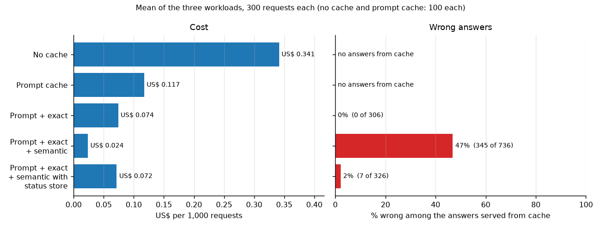

# llm-cache-layers

How much does caching cut the cost of an LLM assistant, and when does it start serving wrong answers? This repository measures it on a customer-service assistant for a fictional store, using `gpt-5.4-nano` on Azure Foundry.

The full report, with method, charts and limitations, is in [docs/REPORT.md](docs/REPORT.md). Versão em português: [README.pt-BR.md](README.pt-BR.md).

## Cache types tested

| Cache | How it works | Is the model still called? |
|---|---|---|
| Prompt | The provider reuses the processing of the start of the prompt when it is identical to a recent call | Yes, with cheaper input |
| Exact | The same question, with the same data, gets the stored answer | No |
| Semantic | A question with a similar meaning gets the stored answer | No |
| Semantic with a status store | A group of similar questions answers from the cache only after different users received matching answers. One divergence blocks the group | Only while the group is not approved |

## Results



Each bar adds one layer to the one above. Left: cost. Right: how many of the answers served from a cache were wrong.

| Strategy | Cost compared with no cache | Wrong among answers served from cache |
|---|---|---|
| Prompt cache | 66% lower | No answers from cache |
| Prompt + exact | 78% lower at 300 requests. At 1,000, 73% to 94% lower, depending on how repetitive the questions are | 0 of 306 |
| + semantic, no control | 93% lower | 345 of 736 (47%) |
| + semantic filtered by an LLM classifier | 75% lower, more expensive than prompt + exact alone | 52 of 407 (13%) |
| + semantic with a status store | 79% lower | 7 of 326 (2%) |
| + status store and a digit rule | 79% lower | 0 of 310 |

Rows with a semantic cache use a similarity threshold of 0.80 and 300 requests per workload. The LLM classifier and the digit rule are variants explained in the report.

## Findings

1. **Start with the prompt cache.** Keep the fixed content at the start of the prompt and what changes at the end. It cut cost by 66% without changing any answer.
2. **Then the exact cache.** It made no errors, and it pays off more as volume grows. With highly repetitive questions, 81% of 1,000 requests never reached the model.
3. **An uncontrolled semantic cache is risky.** It gave one customer's points balance to another, and answered the delivery time for the countryside to someone asking about a state capital. The similarity threshold does not fix this: the wrong answers had higher similarity than the right ones.
4. **Using an LLM to decide what may be cached did not pay off.** The decision costs one call per question, and it still let errors through.
5. **Moving the decision to a database worked better.** The status store blocked personal questions on its own, with no model call. With one simple rule (a question that contains a digit skips the semantic cache), it made no errors at threshold 0.80.
6. **The safe semantic cache barely cut cost in this test.** With 1,000 requests it avoided 1 to 3 calls beyond the exact cache. The workload has few phrasings per question, so there was little for it to gain. Measuring its real potential needs questions with more variation in wording.

## When the semantic cache is worth it

It tends to pay off when these conditions hold together:

- Questions repeat in meaning but rarely in exact wording.
- The answer does not depend on who asks or on values quoted in the question.
- Volume is high enough for groups to collect confirmations.
- The model call is expensive compared with embeddings and a database lookup.
- An occasional wrong answer is acceptable for the application.

## Running it

Requirements: Python 3.10 or newer and an Azure OpenAI or Foundry resource with one chat deployment and one embeddings deployment.

```bash
cp .env.example .env                     # fill in the endpoint, the key and the deployment names
python lab.py simulate --n 100           # calls and worst-case cost, no API calls
python lab.py run --n 100 --faq-share 0.5 --threshold 0.80 --scenarios ABCDE
pip install -r requirements.txt
python analyze.py                        # charts and tables from results/
```

Every command and option is listed in [AGENTS.md](AGENTS.md).

The questions and the store rules in `data/` are in Brazilian Portuguese. All results were measured on that text, so it is kept as is.

## Contents

| Path | What it is |
|---|---|
| [docs/REPORT.md](docs/REPORT.md) | Technical report |
| [AGENTS.md](AGENTS.md) | Guide for coding agents working on this repository |
| [llms.txt](llms.txt) | Repository index for language models |
| `lab.py` | Workloads, scenarios and API calls |
| `analyze.py` | Tables and charts |
| `data/` | System prompt and questions of the fictional store |
| `results/` | Raw data of every run |

## Limitations

One model, one region, synthetic workloads and one seed per workload. The numbers compare the strategies with each other in this setting and are not a forecast for another application. The full list is in the report.

## License

[MIT](LICENSE)
