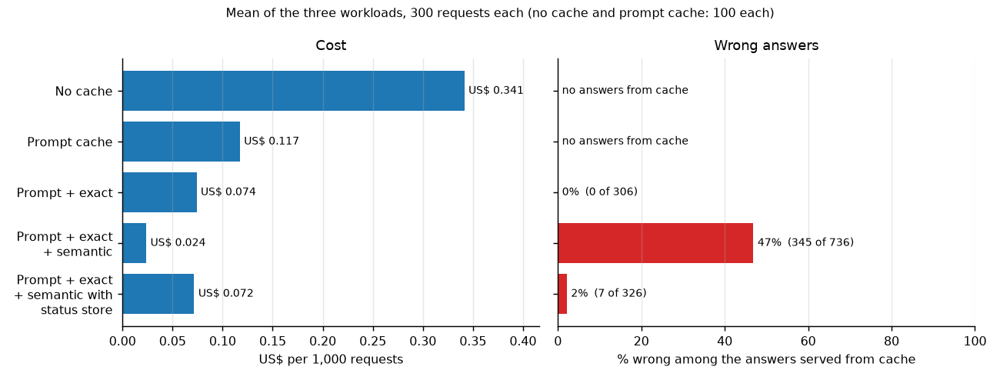

# llm-cache-layers

Quanto um cache reduz o custo de um assistente com LLM, e quando ele começa a devolver resposta errada? Este repositório mede isso em um assistente de atendimento de uma loja fictícia, com `gpt-5.4-nano` no Azure Foundry.

O relatório técnico está em inglês, em [docs/REPORT.md](docs/REPORT.md). English version: [README.md](README.md).

## Os tipos de cache testados

| Cache | Como funciona | O modelo ainda é chamado? |
|---|---|---|
| De prompt | O serviço reaproveita o processamento do início do prompt quando ele é idêntico ao de uma chamada recente | Sim, com entrada mais barata |
| Exato | A mesma pergunta, com os mesmos dados, recebe a resposta guardada | Não |
| Semântico | Uma pergunta parecida em significado recebe a resposta guardada | Não |
| Semântico com banco de status | Um grupo de perguntas parecidas só responde do cache depois que usuários diferentes receberam respostas iguais. Uma divergência bloqueia o grupo | Só enquanto o grupo não é liberado |

## Resultado



Cada barra acrescenta uma camada à anterior. À esquerda, o custo. À direita, quantas das respostas devolvidas pelo cache estavam erradas.

| Estratégia | Custo em relação a não ter cache | Respostas erradas entre as vindas do cache |
|---|---|---|
| Cache de prompt | 66% menor | Não responde do cache |
| Prompt + exato | 78% menor com 300 requisições. Com 1.000, de 73% a 94%, conforme a repetição das perguntas | 0 de 306 |
| + semântico sem controle | 93% menor | 345 de 736 (47%) |
| + semântico com classificador LLM | 75% menor, mais caro que só prompt + exato | 52 de 407 (13%) |
| + semântico com banco de status | 79% menor | 7 de 326 (2%) |
| + banco de status e regra de números | 79% menor | 0 de 310 |

As linhas com cache semântico usam limiar de similaridade 0,80 e 300 requisições por carga. O classificador LLM e a regra de números são variações explicadas no relatório.

## O que concluímos

1. **Comece pelo cache de prompt.** Basta manter o conteúdo fixo no início do prompt e o que varia no fim. Reduziu o custo em 66% sem mudar nenhuma resposta.
2. **Depois, cache exato.** Não errou e rende mais conforme o volume cresce. Com perguntas muito repetitivas, 81% de 1.000 requisições nem chegaram ao modelo.
3. **Cache semântico sem controle é perigoso.** Ele devolveu o saldo de um cliente a outro e respondeu o prazo do interior para quem perguntou de capital. O limiar de similaridade não resolve: as respostas erradas tinham similaridade maior que as certas.
4. **Usar um LLM para decidir o que pode ir para o cache não compensou.** A decisão custa uma chamada por pergunta e ainda deixou passar erro.
5. **Levar a decisão para um banco de dados funcionou melhor.** O banco de status bloqueou sozinho as perguntas pessoais, sem chamada de modelo. Com uma regra simples (pergunta com número não entra no cache semântico), ficou sem erro no limiar 0,80.
6. **O cache semântico seguro quase não reduziu custo neste teste.** Com 1.000 requisições ele evitou de 1 a 3 chamadas além do cache exato. A carga tem poucas redações por dúvida, então havia pouco para ele ganhar. Medir o potencial real dele exige perguntas com mais variação de texto.

## Quando o cache semântico vale a pena

Ele tende a compensar quando estas condições aparecem juntas:

- As perguntas se repetem em significado, mas quase nunca com o mesmo texto.
- A resposta não depende de quem pergunta nem de valores citados na pergunta.
- O volume é alto o bastante para os grupos acumularem confirmações.
- A chamada ao modelo é cara em relação ao custo de embeddings e de consultar o banco.
- Uma resposta errada ocasional é tolerável para a aplicação.

## Como rodar

Requisitos: Python 3.10 ou mais novo e um recurso Azure OpenAI ou Foundry com uma implantação de chat e uma de embeddings.

```bash
cp .env.example .env                     # preencha o endpoint, a chave e os nomes das implantações
python lab.py simulate --n 100           # mostra as chamadas e o pior caso, sem chamar a API
python lab.py run --n 100 --faq-share 0.5 --threshold 0.80 --scenarios ABCDE
pip install -r requirements.txt
python analyze.py                        # gráficos e tabelas a partir de results/
```

Todos os comandos e argumentos estão em [AGENTS.md](AGENTS.md).

## Licença

[MIT](LICENSE)
