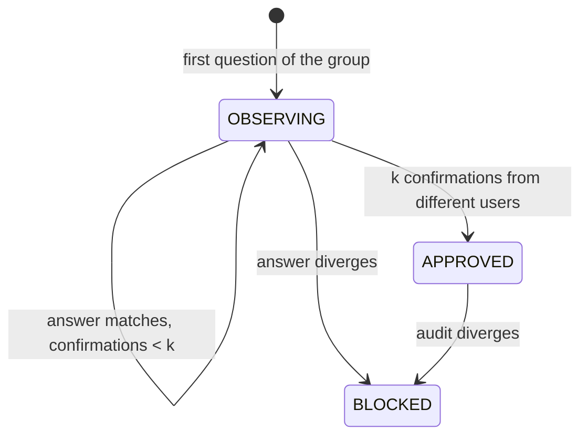
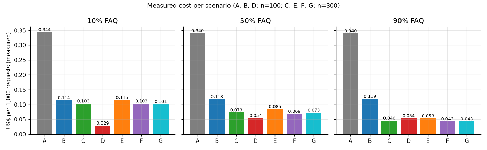
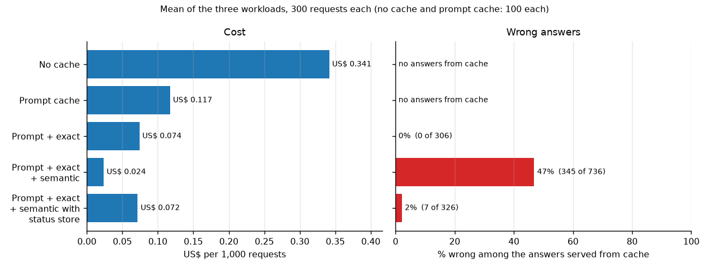
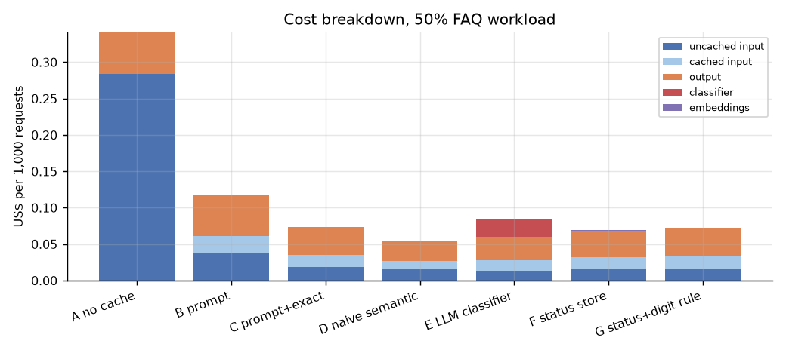
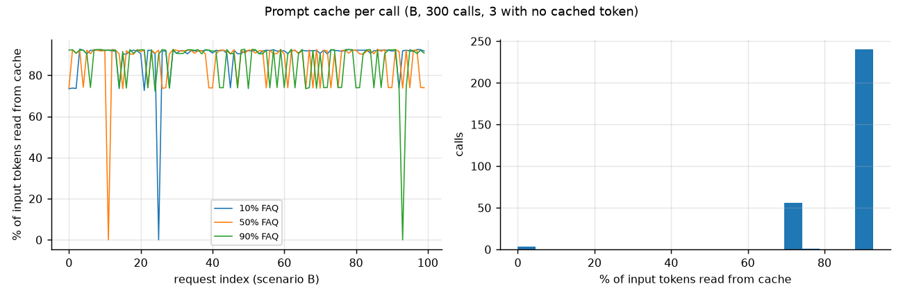
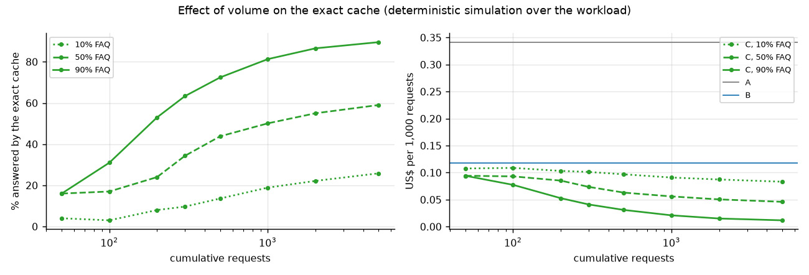
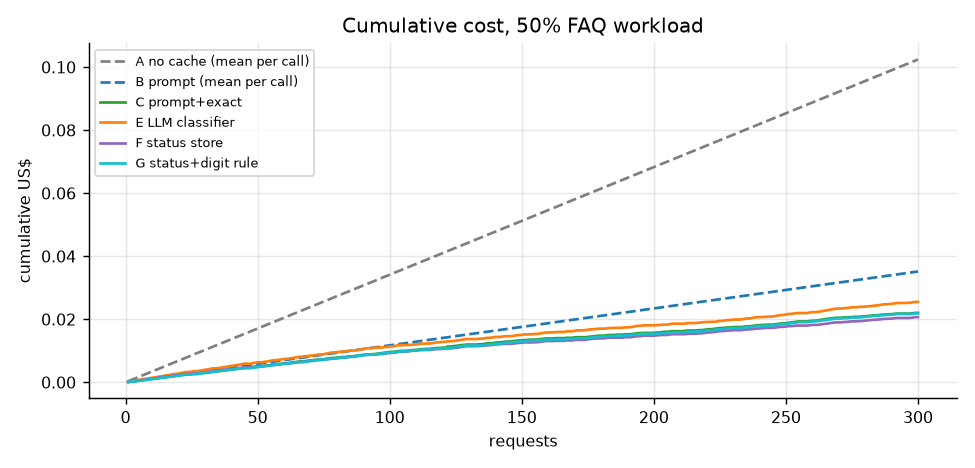
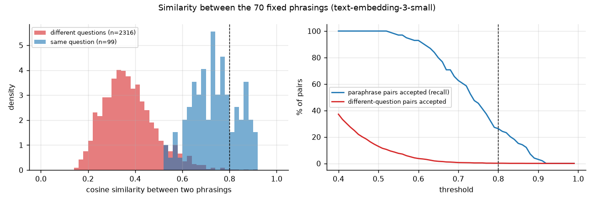
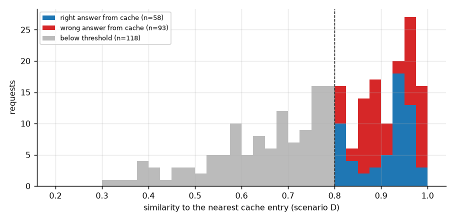
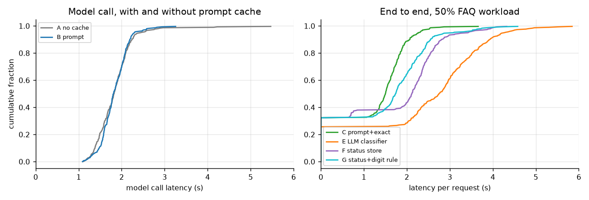

# Technical report: LLM cache layers benchmark

Short version in the [README](../README.md).

This report measures cost, latency and error rate of four caching strategies in a question-answering assistant: prompt cache, exact cache, semantic cache, and a semantic cache gated by a status store.

Run on 2026-11-13 with `gpt-5.4-nano` and `text-embedding-3-small` on Azure Foundry (Global Standard deployment). The benchmark code uses only the Python standard library; `matplotlib` is needed only for the charts.

The questions, the store rules and the classifier prompt are in Brazilian Portuguese. Every number here was measured on that text. Examples in this report carry an English gloss.

## Summary

| Strategy | Cost per 1,000 requests | Wrong answers among semantic cache answers |
|---|---|---|
| A. No cache | US$ 0.340 to 0.344 | not applicable |
| B. Prompt cache | US$ 0.115 to 0.119 (66% lower) | not applicable |
| C. Prompt + exact, 300 requests | US$ 0.046 to 0.103 | 0 |
| C. Prompt + exact, 1,000 requests (simulated) | US$ 0.021 to 0.091 | 0 |
| D. C + semantic for every question, 100 requests | US$ 0.029 to 0.054 | 93 of 151 (62%) |
| D with 300 requests | US$ 0.019 to 0.027 | 345 of 563 (61%) |
| E. C + semantic filtered by an LLM classifier | US$ 0.053 to 0.115 | 52 of 154 (34%) |
| F. C + semantic with a status store | US$ 0.043 to 0.103 | 7 of 24 (29%) |
| G. F + rule for questions with a digit | US$ 0.043 to 0.101 | 0 of 8 |
| G with 1,000 requests, threshold 0.80 | US$ 0.022 to 0.090 | 0 of 47 |
| G with 1,000 requests, threshold 0.70 | US$ 0.022 to 0.090 | 16 of 46 |

The ranges cover the three workloads tested (10%, 50% and 90% frequent questions).

Conclusions the data supports:

1. The prompt cache cut cost by 66% without changing any answer. Latency did not change.
2. The exact cache made no errors, and its gain grows with volume. In the most repetitive workload, the simulation reaches an 81% hit rate at 1,000 requests and 90% at 5,000.
3. The similarity threshold does not separate right from wrong in the semantic cache. In scenario D, wrong hits had a higher median similarity (0.956) than right ones (0.934).
4. The LLM classifier cost 31% of a main model call and avoided only 24% of the remaining calls. It was more expensive than having no semantic cache, and 34% of the semantic answers it allowed were wrong.
5. The status store stopped one customer's data from reaching another without spending a model call. With the digit rule and threshold 0.80 it made no errors.
6. With 1,000 requests, the semantic cache in scenario G avoided 1 to 3 calls beyond the exact cache. Lowering the threshold to 0.70 did not raise that number and brought 16 wrong answers.

## Setup

### Test application

A customer-service assistant for a fictional store. The system prompt is fixed, with 12 sections of rules (`data/system_prompt.md`, about 1,390 tokens together with the question). The customer question goes at the end. Personal questions carry a "Dados do cliente" (customer data) block in the user message.

### Workloads

Each workload mixes three kinds of question (`lab.py`, function `build_workload`):

| Type | Description | Is reusing the answer safe? |
|---|---|---|
| FAQ | 16 frequent questions, each in 4 phrasings | Yes, across phrasings of the same question |
| UNIQUE | 5 question templates with random values (amount, city, days, product) | Only when the expected answer is the same |
| PERSONAL | 3 questions about order, delivery and points balance, for 6 customers | Only for the same customer |

Examples:

| Type | Question | English gloss |
|---|---|---|
| FAQ | "Qual o prazo para trocar um produto?" | What is the deadline to exchange a product? |
| UNIQUE | "Recebi meu pedido ha 18 dias. Ainda posso trocar?" | I received my order 18 days ago. Can I still exchange it? |
| PERSONAL | "Qual o meu saldo de pontos?" | What is my points balance? |

20% of the requests are personal. Of the rest, a share is FAQ (10%, 50% or 90%, depending on the workload) and what is left is UNIQUE. Each request gets a user: the customer, for personal questions, and one of 60 random users for the others.

### Scenarios

| Scenario | What it does |
|---|---|
| A | A random identifier at the start of the system prompt defeats the prompt cache |
| B | Identical system prompt on every call |
| C | B + exact cache: SHA-256 of the normalized message (question and customer data) |
| D | C + semantic cache: embedding of the question, nearest neighbor, threshold 0.80 |
| E | D, but the semantic cache is read and written only when a classifier (`gpt-5.4-nano`, 134-token prompt) answers that the question is reusable |
| F | C + semantic cache with a status per group, in SQLite |
| G | F, and a question that contains a digit never enters the semantic cache |

In scenario F, each group of similar questions has a status:



Only an APPROVED group answers from the cache. Two answers "match" when they contain the same set of numbers and the cosine similarity between their embeddings is at least 0.80. The runs used `k = 2` and an audit of 10% of the hits on approved groups.

### Metrics

- **Cost:** tokens from the `usage` field of each response multiplied by the public price (`prices.json`): input US$ 0.20, cached input US$ 0.02, output US$ 1.25 and embeddings US$ 0.02 per million tokens. Classifier and embedding calls are included.
- **Latency:** wall-clock time of each HTTP call, summed per request. An exact-cache hit counts as zero.
- **Cache error:** a semantic hit is right when the current question and the question that produced the stored answer have the same answer key. The answer key of a FAQ is the question; of a personal question, the question and the customer; of a unique question, a value computed from the store rules (`unique_answer_key`). So "I received my order 18 days ago, can I exchange it?" and "24 days ago" share an answer without error, and "41 days ago" does not, because the exchange window is 30 days.

### Run sizes

| Scenarios | Requests per workload | Note |
|---|---|---|
| A, B, D | 100 | One execution with the five original scenarios |
| C, E, F, G | 300 | One process per scenario and workload |
| D | 300 | Later run, used in the cache-type chart |
| G | 1,000 | Thresholds 0.70 and 0.80 |

## Results

### Cost



| FAQ share | Scenario | n | Model | Exact | Semantic | Wrong | US$/1000 | p50 s | p95 s |
|---|---|---|---|---|---|---|---|---|---|
| 10% | A | 100 | 100 | 0 | 0 | 0 | 0.3441 | 1.86 | 2.37 |
| 10% | B | 100 | 100 | 0 | 0 | 0 | 0.1145 | 1.80 | 2.24 |
| 10% | C | 300 | 273 | 27 | 0 | 0 | 0.1030 | 1.68 | 2.22 |
| 10% | D | 100 | 28 | 1 | 71 | 43 | 0.0292 | 0.76 | 2.83 |
| 10% | E | 300 | 229 | 26 | 45 | 23 | 0.1148 | 3.00 | 4.05 |
| 10% | F | 300 | 273 | 27 | 0 | 0 | 0.1031 | 2.41 | 3.12 |
| 10% | G | 300 | 273 | 27 | 0 | 0 | 0.1013 | 1.83 | 2.78 |
| 50% | A | 100 | 100 | 0 | 0 | 0 | 0.3405 | 1.77 | 2.31 |
| 50% | B | 100 | 100 | 0 | 0 | 0 | 0.1182 | 1.82 | 2.25 |
| 50% | C | 300 | 202 | 98 | 0 | 0 | 0.0734 | 1.50 | 2.26 |
| 50% | D | 100 | 45 | 9 | 46 | 30 | 0.0544 | 0.86 | 2.88 |
| 50% | E | 300 | 164 | 78 | 58 | 18 | 0.0851 | 2.74 | 4.20 |
| 50% | F | 300 | 185 | 98 | 17 | 7 | 0.0689 | 2.11 | 3.26 |
| 50% | G | 300 | 201 | 98 | 1 | 0 | 0.0730 | 1.74 | 2.87 |
| 90% | A | 100 | 100 | 0 | 0 | 0 | 0.3397 | 1.84 | 2.43 |
| 90% | B | 100 | 100 | 0 | 0 | 0 | 0.1190 | 1.81 | 2.48 |
| 90% | C | 300 | 119 | 181 | 0 | 0 | 0.0455 | 0.00 | 2.05 |
| 90% | D | 100 | 48 | 18 | 34 | 20 | 0.0537 | 0.87 | 3.11 |
| 90% | E | 300 | 100 | 149 | 51 | 11 | 0.0530 | 1.84 | 4.14 |
| 90% | F | 300 | 116 | 177 | 7 | 0 | 0.0428 | 0.00 | 3.07 |
| 90% | G | 300 | 116 | 177 | 7 | 0 | 0.0427 | 0.00 | 2.80 |

"Model", "Exact" and "Semantic" count where the answer of each request came from. "Wrong" counts answers served from the cache that did not fit the question.

The cost of D in this table cannot be compared in absolute value with C, E, F and G, because D ran with 100 requests and the others with 300. A later run of D with 300 requests, on the same workloads, gave:

| FAQ share | Model | Exact | Semantic | Wrong | Another customer's data | US$/1000 |
|---|---|---|---|---|---|---|
| 10% | 42 | 6 | 252 | 153 | 40 | 0.0190 |
| 50% | 63 | 53 | 184 | 111 | 48 | 0.0267 |
| 90% | 59 | 114 | 127 | 81 | 57 | 0.0256 |

The share of wrong answers was 61%, against 62% in the 100-request run. The other analyses of D in this report use the 100-request run.

View by cache type, mean of the three workloads:



In this chart the wrong-answer share is taken over every answer served from a cache, exact and semantic together.



Without a cache, 83% of the cost is input tokens. With the prompt cache, output becomes the largest part. In scenario E, the classifier accounts for 30% of the total cost.

### Prompt cache

| Scenario | Calls | Input | Cached | Cached % | Output | US$ per call |
|---|---|---|---|---|---|---|
| A | 300 | 1,420 | 0 | 0.0 | 46 | 0.000341 |
| B | 300 | 1,394 | 1,219 | 87.4 | 46 | 0.000117 |
| C | 594 | 1,393 | 1,250 | 89.7 | 47 | 0.000112 |
| E | 493 | 1,394 | 1,267 | 90.9 | 47 | 0.000109 |
| F | 574 | 1,394 | 1,256 | 90.1 | 47 | 0.000112 |
| G | 590 | 1,393 | 1,266 | 90.9 | 48 | 0.000110 |



- In B, 3 of the 300 calls read nothing from the cache. The median was 91.8% of the input tokens.
- The median `cached_tokens` value was 1,280 in a prompt of about 1,394 tokens. This is consistent with what the Azure documentation describes for models before GPT-5.6: hits start at 1,024 tokens and grow in 128-token increments. The next step, 1,408, is already larger than the prompt.
- The 66% reduction in cost per call comes from the input alone. The cached-token price is 10% of the regular price.

### Exact cache and volume

Exact-cache hits depend only on the sequence of questions, so larger volumes can be simulated without calling the API. The table uses the mean cost measured per model call in scenario C (US$ 0.000112).

| FAQ share | Metric | 50 | 100 | 200 | 300 | 500 | 1,000 | 2,000 | 5,000 |
|---|---|---|---|---|---|---|---|---|---|
| 10% | hit rate | 4% | 3% | 8% | 10% | 14% | 19% | 22% | 26% |
| 10% | US$/1000 | 0.1076 | 0.1087 | 0.1031 | 0.1013 | 0.0969 | 0.0909 | 0.0873 | 0.0832 |
| 50% | hit rate | 16% | 17% | 24% | 34% | 44% | 50% | 55% | 59% |
| 50% | US$/1000 | 0.0942 | 0.0930 | 0.0852 | 0.0736 | 0.0630 | 0.0559 | 0.0504 | 0.0460 |
| 90% | hit rate | 16% | 31% | 53% | 63% | 72% | 81% | 87% | 90% |
| 90% | US$/1000 | 0.0942 | 0.0774 | 0.0527 | 0.0411 | 0.0309 | 0.0210 | 0.0151 | 0.0117 |



The simulation at 300 requests gave US$ 0.0736 for the 50% workload, close to the value measured with a different seed (US$ 0.0734). The hit rate is bounded by the workload mix: unique questions never repeat, and the set of repeatable messages here is small (64 FAQ phrasings and 36 combinations of personal question and customer).



### Semantic cache

#### Similarity between questions



Among the 70 fixed phrasings (FAQ and personal), pairs of the same question have a median similarity of 0.734 and a minimum of 0.526. Pairs of different questions have a median of 0.364 and a maximum of 0.904.

| Threshold | Paraphrase pairs accepted | Different-question pairs accepted | Precision among accepted pairs |
|---|---|---|---|
| 0.60 | 92.9% | 3.71% | 52% |
| 0.70 | 62.6% | 0.65% | 81% |
| 0.75 | 45.5% | 0.39% | 83% |
| 0.80 | 26.3% | 0.17% | 87% |
| 0.85 | 15.2% | 0.09% | 88% |
| 0.90 | 3.0% | 0.04% | 75% |

No threshold goes above 88% precision on this set. The most similar pairs of different questions are questions that differ in one word that changes the answer: "Quanto tempo leva a entrega nas capitais?" (how long does delivery take in state capitals?) and "Quanto tempo leva a entrega fora das capitais?" (outside state capitals) score 0.904.

#### Errors by question type

| Scenario | Type | Right | Wrong | Precision |
|---|---|---|---|---|
| D | FAQ | 17 | 4 | 81% |
| D | UNIQUE | 41 | 51 | 45% |
| D | PERSONAL | 0 | 38 | 0% |
| E | FAQ | 67 | 16 | 81% |
| E | UNIQUE | 35 | 36 | 49% |
| F | FAQ | 8 | 0 | 100% |
| F | UNIQUE | 9 | 7 | 56% |
| G | FAQ | 8 | 0 | 100% |



- Every semantic hit on a personal question in scenario D delivered another customer's answer. The question text is identical ("Qual o meu saldo de pontos?"), so the similarity is close to 1.0.
- 52 of the 93 wrong hits in D had a similarity of 0.95 or more. Raising the threshold removes the right hits first.
- Even restricted to FAQs, the semantic cache with threshold 0.80 was wrong 19% of the time in D and E.

### LLM classifier

| True type | Expected label | REUSABLE | NOT_REUSABLE | Accuracy |
|---|---|---|---|---|
| FAQ | REUSABLE | 178 | 9 | 95.2% |
| UNIQUE | NOT_REUSABLE | 89 | 288 | 76.4% |
| PERSONAL | NOT_REUSABLE | 1 | 82 | 98.8% |

The classifier receives only the question text. It separated personal questions well, but it let through 24% of the questions with specific values.

Each classification cost US$ 0.0000341 on average (134 input tokens, uncached because the prompt is below 1,024 tokens, and 6 output tokens). A main model call with the prompt cache cost US$ 0.000109. The classifier runs on every request that misses the exact cache, so it pays off only if the semantic cache avoids more than 31% of those calls. In the test it avoided 154 of 647 (24%), wrong hits included.

### Status store

| Scenario | FAQ share | Approved | Observing | Blocked | Answers served |
|---|---|---|---|---|---|
| F | 10% | 1 | 14 | 21 | 0 |
| F | 50% | 3 | 34 | 20 | 17 |
| F | 90% | 3 | 41 | 15 | 7 |
| G | 10% | 0 | 14 | 8 | 0 |
| G | 50% | 3 | 31 | 9 | 1 |
| G | 90% | 3 | 36 | 11 | 7 |

- **Blocking personal data:** of the 83 personal requests that reached the store in scenario F, 47 matched a group that was already blocked, 18 a group under observation, and 18 opened a new group. None was answered by the semantic cache.
- **Approval by coincidence:** the 7 errors in F come from a single group, "Recebi meu pedido ha N dias. Ainda posso trocar?" (I received my order N days ago, can I still exchange it?). The first questions had N below 30, the answers matched, and the group was approved. It then answered "yes" for 34, 39, 41, 43, 49, 51 and 58 days.
- **Audit:** none of the 24 answers served in F fell in the 10% sample. The mechanism was barely exercised in this benchmark.
- **Few approved groups:** 97 of the 138 FAQ requests that reached the store opened a new group. With threshold 0.80, only 26% of paraphrase pairs find each other, so confirmations are spread over many small groups.
- **Digit rule (G):** it kept every question with a digit out of the semantic cache, which removed the errors and reduced embedding calls. The side effect is that any question with a number is treated as not reusable, including those that could be reused.

### Scenario G with 1,000 requests

This run checks whether more volume or a lower threshold raises the yield of the semantic cache without bringing errors. The "exact only" column is the simulation of scenario C over the same workload.

| FAQ share | Threshold | Calls with exact only | Calls in G | Avoided by semantic | Workload ceiling | Semantic answers | Wrong | US$/1000 |
|---|---|---|---|---|---|---|---|---|
| 10% | 0.70 | 787 | 785 | 2 | 28 | 2 | 0 | 0.0901 |
| 10% | 0.80 | 787 | 786 | 1 | 28 | 1 | 0 | 0.0895 |
| 50% | 0.70 | 495 | 492 | 3 | 48 | 34 | 16 | 0.0576 |
| 50% | 0.80 | 495 | 492 | 3 | 48 | 18 | 0 | 0.0569 |
| 90% | 0.70 | 179 | 178 | 1 | 48 | 10 | 0 | 0.0218 |
| 90% | 0.80 | 179 | 176 | 3 | 48 | 28 | 0 | 0.0216 |

- **Workload ceiling:** the semantic cache can only avoid the call for a new phrasing of a question that was already answered. The workload has 16 questions in 4 phrasings, so the ceiling is the number of distinct phrasings that appeared minus the number of questions: 28 calls in the 10% workload and 48 in the others.
- **Semantic answers and avoided calls are different numbers.** A message answered by the semantic cache is not written to the exact cache, so its repetitions keep being answered by the semantic cache. Those repetitions would have been exact hits anyway.
- **Avoided calls:** 1 to 3 in 1,000, in all six cases. Almost every FAQ phrasing went to the model once before its group was approved.
- **Threshold 0.70:** the 16 wrong answers come from one group. The questions about returning a product within the cooling-off period confirmed each other and the group was approved. After that, questions about exchanging a product (similarity 0.73 to 0.81 with the group) received the 7-day deadline in place of the 30-day one.
- **Audit:** it was drawn once across the six runs.

### Latency

Requests that reached the main model. In E, F and G the time includes the classifier or embedding calls.

| Scenario | n | p50 | p90 | p99 | mean |
|---|---|---|---|---|---|
| A | 300 | 1.82 | 2.24 | 2.97 | 1.84 |
| B | 300 | 1.81 | 2.19 | 2.79 | 1.83 |
| C | 594 | 1.69 | 2.12 | 3.64 | 1.80 |
| E | 493 | 3.23 | 4.12 | 5.85 | 3.37 |
| F | 574 | 2.42 | 3.04 | 4.13 | 2.52 |
| G | 590 | 1.97 | 2.67 | 4.73 | 2.13 |



- The prompt cache did not change latency with this 1.4k-token prompt: p50 of 1.82 s without it and 1.81 s with it.
- In scenario E the median was about 1.5 s higher than in C. The classifier call is sequential and comes before the main call.
- Scenario F makes more embedding calls than G, which skips questions with a digit. This is the likely explanation for the difference between the two; it was not isolated.

## Cost model

Cost of one model call, with `I` input tokens, `K` of them read from the cache, and `O` output tokens:

```
c_model = (I - K) * p_input + K * p_cached + O * p_output
```

Expected cost per request, with exact hit rate `h_e`, semantic hit rate `h_s` among the requests that missed the exact cache, and decision cost `c_dec` (classifier, embeddings, or both):

```
c_req = (1 - h_e) * [ c_dec + (1 - h_s) * c_model ]
```

The semantic cache lowers cost when `h_s > c_dec / c_model`. With the measured values:

| Decision | c_dec | c_dec / c_model | Measured h_s |
|---|---|---|---|
| LLM classifier + embeddings (E) | US$ 0.0000341 | 31% | 24%, with 34% wrong |
| Embeddings only (D) | under US$ 0.000001 | under 1% | 56%, with 62% wrong |
| Status store + digit rule (G) | under US$ 0.000003 | under 3% | 1%, no errors |

The cost of a wrong answer is outside this formula and depends on the application.

## Closing remarks

**Order of adoption.** The data points to the prompt cache first, the exact cache next, and the semantic cache last, restricted to generic questions and kept under control. The first two layers gave a 66% to 94% reduction with no wrong answer.

**Coverage and precision of the semantic cache.** In the 100- and 300-request runs, each control that raised precision reduced how much the cache answered:

| Variant | Requests answered by the semantic cache | Precision |
|---|---|---|
| D. Every question | 50% | 38% |
| E. LLM classifier | 17% | 66% |
| F. Status store | 3% | 71% |
| G. Status store + digit rule | 1% | 100% |

**What decides whether the semantic cache pays off.** Precision is the condition for it to be usable. The gain depends on three more factors:

- How many questions arrive with a wording different from one already answered. The exact cache covers literal repetitions, and the semantic cache only earns on what is left.
- How much a wrong answer costs the application. The more expensive the error, the higher the precision has to be and the fewer questions are left for the cache.
- How much the model call costs. With a more expensive model, each hit saves more, and the cost of deciding with embeddings and a store stays the same.

**Deciding in the system instead of in the model.** The status store and the digit rule replaced the LLM classifier at a lower cost and with fewer errors. The store uses agreement between answers as its signal and does not need to interpret the question. The failure observed was approval by coincidence, when the first answers of a group match and later ones should not.

**What this test does not answer.** The potential of the semantic cache in an application with open-ended questions. With 4 phrasings per question, the ceiling was 48 calls in 1,000. Measuring that potential needs a workload with many phrasings per question, for example paraphrases generated by a model or real user questions.

## Limitations

- One model, one region, one day. Prices and prompt cache behavior change by model.
- One seed per workload. There are no confidence intervals.
- Synthetic workloads. The real distribution of questions in a product can be more or less repetitive.
- The detailed analyses of scenario D use the 100-request run per workload; the other semantic scenarios use 300.
- Each frequent question has only 4 phrasings. This limits what the semantic cache can gain over the exact cache.
- The processes for C, E, F and G ran in parallel with the same system prompt, so they shared the service's prompt cache. This tends to raise the cached share compared with an isolated process.
- Scenario A has about 26 more tokens per call, because of the random identifier.
- The answer key measures whether the reused answer fits the question. The quality of the model's answers was not evaluated.
- Latency was measured from a single client, with sequential calls. In-memory cache lookups were not timed. The embedding latency of a repeated question is the one from its first call.
- Cost comes from tokens times list price, and was not checked against an invoice.
- Cache entry expiry, invalidation when the rules change, and concurrency were not tested.
- The questions are in Brazilian Portuguese. Similarity distributions can differ in other languages and with other embedding models.

## Reproducing

Requirements: Python 3.10 or newer (tested on 3.13) and an Azure OpenAI or Foundry resource with one chat deployment and one embeddings deployment.

```bash
cp .env.example .env          # fill in the endpoint, the key and the deployment names
python lab.py calibrate       # similarity distribution of the fixed questions
python lab.py simulate --n 100 # calls and worst-case cost, no API calls
python lab.py run --n 100 --faq-share 0.5 --threshold 0.80 --scenarios ABCDE
python lab.py run --n 300 --faq-share 0.5 --threshold 0.80 --scenarios F --max-calls 950
python lab.py run --n 1000 --faq-share 0.5 --threshold 0.80 --scenarios G --max-calls 3100
python lab.py project --n 1000
pip install -r requirements.txt
python analyze.py             # charts in docs/img and tables in the terminal
```

`--max-calls` stops the run when the number of API calls goes over the limit.

## Layout

```
lab.py            workloads, scenarios, API calls and commands
analyze.py        tables and charts from results/
prices.json       prices used in the cost calculation
data/system_prompt.md   system prompt with the rules of the fictional store (Portuguese)
data/questions.json     frequent questions, personal questions and customers (Portuguese)
results/          one row per request (.jsonl), summaries (.json) and the stores of scenarios F and G (.sqlite)
docs/img/         charts of this report
AGENTS.md         guide for coding agents
llms.txt          index of the repository for language models
```
